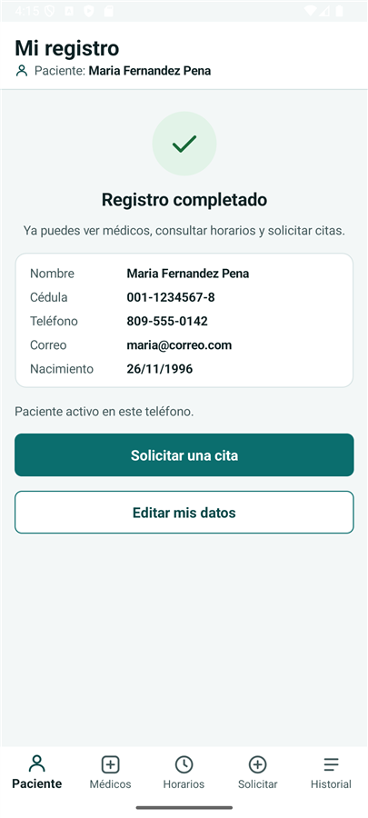
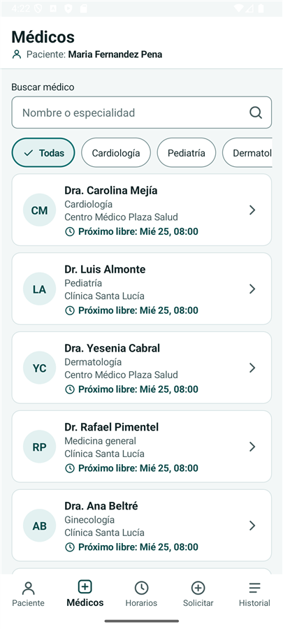
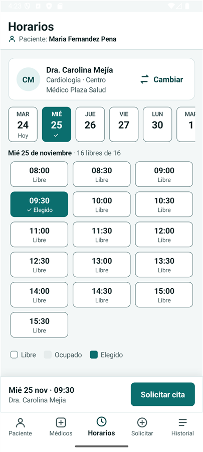
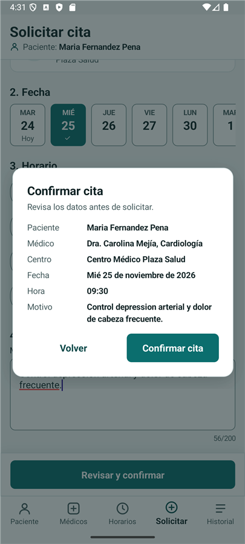
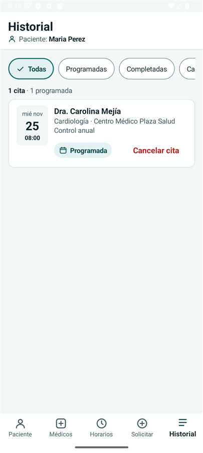

# Citas Médicas

Aplicación móvil Android (.NET MAUI) para administrar citas entre pacientes y centros médicos. Un paciente se registra, consulta médicos, revisa horarios disponibles, solicita una cita y sigue su historial. Los datos se guardan en el teléfono con SQLite.

Proyecto final de Programación IV: *Sistema de Gestión de Citas Médicas*.

| Registro | Médicos | Horarios | Solicitar | Historial |
| --- | --- | --- | --- | --- |
|  |  |  |  |  |

Hay 18 capturas de todas las pantallas y estados en [`docs/capturas`](docs/capturas).

## Funcionalidades

- **Registro de pacientes**: nombre, cédula única (`000-0000000-0`), teléfono de 10 dígitos, correo opcional y fecha de nacimiento. Todos los errores se muestran a la vez; una cédula repetida no guarda nada. El paciente puede editar sus datos.
- **Listado de médicos**: 9 médicos de ejemplo con especialidad y centro, búsqueda por nombre o especialidad combinable con el filtro por especialidad, y el próximo horario libre de cada uno.
- **Consulta de fechas y horarios**: bloques de 30 minutos de 08:00 a 16:00, de lunes a viernes. Los ocupados se calculan a partir de las citas programadas; un día lleno ofrece ir al próximo día con hueco.
- **Solicitud de citas**: médico, fecha, horario y motivo (máximo 200 caracteres), con una confirmación previa. La disponibilidad se revisa de nuevo al confirmar: si el horario ya fue tomado, no se guarda nada y se conservan los datos escritos.
- **Historial de citas**: la más reciente primero, con filtro por estado (Programada, Completada, Cancelada). Solo las programadas se cancelan, con confirmación, y el horario queda libre.
- **Recuperación ante fallos**: si el archivo de datos se daña, la app ofrece reintentar o empezar de cero, y conserva una copia del archivo dañado.

## Cómo está hecha

```
CitasMedicas.App   ── vistas XAML, ViewModels, controles, navegación Shell (5 pestañas)
        │
CitasMedicas.Core  ── modelos, repositorio SQLite y servicios con las reglas de negocio
        │
CitasMedicas.Core.Tests ── 119 pruebas xUnit sobre el núcleo
```

- Las reglas de negocio viven en `CitasMedicas.Core`, sin dependencias de MAUI, y se prueban allí; la interfaz solo las llama.
- Un médico no puede tener dos citas **programadas** en el mismo horario: lo comprueba el código y lo impone la base de datos con un índice único parcial. Cancelar una cita libera su horario.
- Los bloques ocupados no se guardan: se derivan de las citas programadas.
- La interfaz sale de un sistema de diseño ([`design/system.md`](design/system.md)): contraste suficiente, etiquetas siempre visibles, objetivos táctiles de al menos 44 px y estados que nunca dependen solo del color.

## Ejecutar

Requisitos: SDK de .NET 10 con el workload `maui-android`, JDK 21 y el SDK de Android con un emulador (por ejemplo `Medium_Phone_API_36.0`).

```bash
export JAVA_HOME="C:/Users/ogand/.jdks/jbr-21.0.7"; export PATH="$JAVA_HOME/bin:$PATH"
dotnet test CitasMedicas.Core.Tests
dotnet build CitasMedicas.App -t:Run -f net10.0-android
```

Ajusta `JAVA_HOME` a tu instalación de JDK 21 (con el JDK 24 falla con `XA0030`). Con el emulador abierto, la app se instala y se lanza sola. Si no queda en primer plano: `adb shell am start -n com.citasmedicas.app/crc6452d1be0e8d06e841.MainActivity`.

Los builds de depuración usan Fast Deployment: no borres los datos con `adb shell pm clear` (el arranque aborta). Para empezar de cero usa `adb uninstall com.citasmedicas.app` y vuelve a ejecutar.

## Pruebas

`dotnet test CitasMedicas.Core.Tests` ejecuta 119 pruebas:

| Área | Pruebas |
| --- | --- |
| Repositorio SQLite (datos iniciales, duplicados, concurrencia, archivo corrupto) | 19 |
| Horarios (bloques, días hábiles, ocupados, próximo libre) | 23 |
| Pacientes (validación, cédula única, actualización) | 43 |
| Citas (solicitud, duplicados, pasado, cancelación, historial) | 34 |

Incluyen los caminos de fallo: datos inválidos, límites de tiempo, 20 solicitudes simultáneas al mismo horario (gana una sola), reapertura de la base y archivos dañados.

La interfaz se verificó en el emulador por `adb`, con capturas en [`evidence`](evidence): flujo completo, botón Atrás en los diálogos, doble toque simultáneo (una sola cita), cancelación, horario ya tomado y base de datos dañada.

## Documentación

| Ruta | Contenido |
| --- | --- |
| [`docs/entrega`](docs/entrega) | Conclusiones, Bibliografía y Anexos del trabajo (Word y PDF) y el guion de exposición |
| [`docs/capturas`](docs/capturas) | Capturas de todas las pantallas y estados |
| [`design`](design) | Diseño de las 5 pantallas y sistema de diseño |
| [`odd/tasks/citas-medicas.md`](odd/tasks/citas-medicas.md) | Especificación, tareas y registro del desarrollo |

## Alcance

Esta primera versión funciona en un solo teléfono, sin servidor. No incluye inicio de sesión ni contraseñas, reprogramación de citas, horarios distintos por médico ni una acción en pantalla para marcar una cita como completada. Los nueve médicos son datos de ejemplo. Se probó en un emulador Android, no en dispositivos físicos. El detalle está en los anexos A y B de [`docs/entrega`](docs/entrega).
